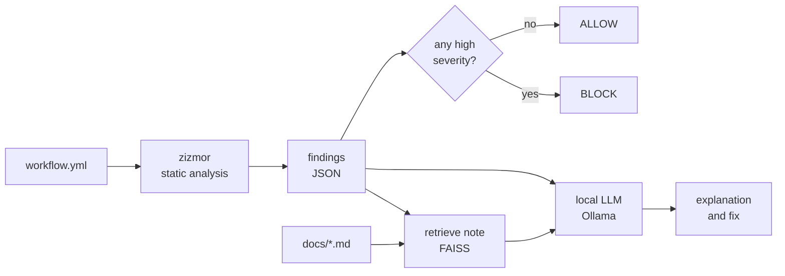

# gha-workflow-vetting-sandbox

[](https://github.com/ppereira13/gha-workflow-vetting-sandbox/actions/workflows/ci.yml)

A small prototype that checks a GitHub Actions workflow before it is allowed to run.
It runs a static analyser, asks a local LLM to explain each finding using retrieved
security notes, and ends with a block or allow verdict.

I built it to learn the problem space of CI/CD supply chain security by doing. It is a
learning project, not a finished tool.

## Why

A workflow file decides what code runs in a pipeline and which secrets that code can
reach. A third-party action referenced by a tag, a trigger that hands secrets to pull
requests from forks, or a pull request title pasted into a shell command are all small
details that are easy to miss in review. In March 2025 the `tj-actions/changed-files`
action was compromised and its tags were repointed to malicious code, which leaked
secrets from many repositories that had done nothing but reference a tag.

Static analysers catch known patterns, but their output is short and assumes the reader
already knows the attack. This prototype tries one idea: keep the static analyser as the
source of truth for what is wrong, and use an LLM only to explain the finding and
recommend the fix, grounded on reference notes instead of on its own memory.

## How it works



1. `vetter/vet.py` runs [zizmor](https://docs.zizmor.sh/) on the workflow and reads its
   JSON output.
2. `vetter/rag.py` embeds the notes in `docs/` with `nomic-embed-text`, stores the
   vectors in a FAISS index and returns the note closest to each finding.
3. The finding, the retrieved note and the workflow are sent to `llama3.2` running
   locally through Ollama. Nothing leaves the machine.
4. The script prints each finding with its source note and the model's explanation,
   then a verdict. It exits with code 1 when the verdict is BLOCK, so it can gate a
   pipeline.

## Repository layout

```
.github/workflows/ci.yml   CI: unit tests and a zizmor audit of this repo's own workflows
sample_app/, tests/        tiny Python package, only there to give the CI something to test
examples/vulnerable.yml    deliberately insecure workflow used as input (never executed)
vetter/vet.py              orchestrator: zizmor, retrieval, LLM, verdict
vetter/rag.py              embeddings and FAISS search
docs/                      short security notes used as the knowledge base
infra/Vagrantfile          disposable Ubuntu VM (VirtualBox)
infra/playbook.yml         Ansible: installs Docker, builds the image, runs the audit
infra/Dockerfile           container image with zizmor
```

## Running it

Requirements: Python 3.11, [Ollama](https://ollama.com/) and the two models.

```
ollama pull llama3.2
ollama pull nomic-embed-text

python -m venv .venv
.venv\Scripts\Activate.ps1          # Windows. On Linux/macOS: source .venv/bin/activate
python -m pip install -r requirements.txt -r requirements-dev.txt

python vetter/vet.py examples/vulnerable.yml
```

Shortened output:

```
[High] template-injection: code injection via template expansion
Sources: script-injection.md
The workflow is vulnerable to template injection due to the use of untrusted input
(${{ github.event.pull_request.title }}) directly in the script. [...] I recommend
passing the untrusted value through an environment variable [...]

[High] unpinned-uses: unpinned action reference
Sources: pinning-actions.md
[...] pin the action to a full-length commit SHA [...]

VERDICT: BLOCK (3 high severity findings)
```

Running it on this repository's own `ci.yml` gives `VERDICT: ALLOW`.

## Running the static analysis in a disposable VM

`infra/` runs the zizmor step away from the host. Vagrant creates an Ubuntu VM, Ansible
(running inside the VM) installs Docker and builds a small image, and zizmor runs in a
container with no network and a read-only mount of the workflow.

```
cd infra
vagrant up          # create the VM, provision it and print the findings
vagrant destroy -f  # throw everything away
```

It needs VirtualBox and Vagrant. The `Vagrantfile` points to an Ubuntu 24.04 box
that I already had on my machine, so it is not downloadable. Change `config.vm.box` to
a public Ubuntu 24.04 box to reproduce it (I have not tested other boxes). Only the static
analysis runs in the VM for now. The LLM step still runs on the host.

## What I observed

I ran the five findings of `examples/vulnerable.yml` through the model twice, once
without retrieval and once with it, and checked each explanation by hand.

| Finding | Without retrieval | With retrieval |
|---|---|---|
| artipacked | wrong, invented an option that does not exist | correct |
| excessive-permissions | wrong, talked about an unrelated secret | correct |
| dangerous-triggers | wrong, blamed the checkout `ref` | correct |
| template-injection | wrong, blamed `echo` | right idea, but the suggested snippet left out the `env:` block |
| unpinned-uses | partly right, suggested another tag instead of a commit SHA | correct |

This is one run on one workflow with a 3B model, so it is an observation and not a
measurement. It was still enough to convince me that a small local model should not be
trusted to explain security findings from memory, and that even a five-document
knowledge base changes the result a lot.

## Limitations

- The LLM only explains what zizmor already found. It does not yet look for risks the
  static analyser misses, such as the combination in the example of checking out
  untrusted code and then running `./deploy.sh` with a secret in scope.
- The verdict is a fixed rule (any high severity finding blocks). The model has no say
  in it.
- The knowledge base has five notes, each retrieved as a whole document. There is no
  chunking and the index is rebuilt on every run.
- Model output is not deterministic and was checked by hand on a single example. There
  is no automated evaluation.
- The explanation can still be incomplete, as in the template-injection case above.
- Only one analyser and one model were tried.

## Security choices in this repository

- The CI workflow sets `permissions: contents: read`, pins actions to full commit SHAs
  and disables credential persistence on checkout.
- zizmor audits the repository's own workflows on every push and pull request.
- The vulnerable example lives outside `.github/workflows`, so GitHub never runs it.
- The workflow under review is only read as text. It is never executed.

## Next steps

- Move the whole pipeline, including the LLM step, into the disposable VM, so that each
  analysis starts from a clean environment and leaves nothing behind.
- Let the LLM review the workflow as a whole and report risks that span several
  findings.
- Try the tool on real public workflows and count correct, incomplete and wrong
  explanations.
- Split the notes into smaller chunks, add more sources and persist the index.

## Sources

The notes in `docs/` are my own summaries. The guidance comes from the pages listed in
[docs/README.md](docs/README.md).

## License

MIT
